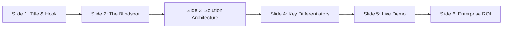

# PromotionProof — Hackathon Winning Presentation & Demo Guide

> **"Standard CI/CD validation proves a change CAN deploy. PromotionProof proves it is the RIGHT change."**

---

## 🏆 1. The Core Winning Pitch (The Hook)

### The Problem standard tools miss:
Salesforce metadata files are **multi-tenant XML containers**. A single `CustomField` file contains 50 picklist values; a single `PermissionSet` contains hundreds of security rules.

During Git merges, AI code generation, or cherry-picking:
1. Developer gets approval for **1 new picklist value** (`API Failure Opt Out Exception`).
2. An unrelated picklist value (`Account Information Category`) or security escalation enters the same XML file.
3. **Standard Copado/Salesforce Deployment Validation passes green (100% valid XML)**.
4. **Result**: Unapproved logic or security vulnerabilities leak into Production.

### The Innovation:
**PromotionProof** is an **intent-aware, authorization-bound release guardrail** powered by Copado Agentia. It introduces **Semantic Change Contracts with Cryptographic SHA Digest Binding**, ensuring that only human-authorized metadata reaches deployment.

---

## 📊 2. Slide-by-Slide PPT Structure



---

### Slide 1: Cover & Elevating Quote
- **Title**: **PromotionProof** — Authorization-Aware Semantic Release Control for Copado Agentia
- **Subtitle**: *Stopping unauthorized Salesforce metadata creep before it hits production.*
- **Presenter**: Pratik Tiwari (Copado Hackathon 2026)
- **Key Visual**: Side-by-side comparison icon: Green Validation Checkmark vs. Red PromotionProof Authorization Shield.

---

### Slide 2: The Hidden DevOps Blindspot
- **Headline**: *Valid Deployment ≠ Authorized Deployment*
- **Bullet Points**:
  - **The Container Problem**: Salesforce XML components bundle multiple business logic items together.
  - **The Dirty Merge Risk**: Branch merges and AI tools merge valid metadata, but leak unapproved fields.
  - **The Validation Flaw**: Salesforce Deployment Validation only checks syntax (`Can it compile?`), not intent (`Was it approved?`).
- **Speaker Note**: *"Imagine a developer asking approval for 1 picklist value, but 2 values get merged into the XML. Salesforce says 'Both values are valid XML, deployment passed!' But business governance was violated. PromotionProof solves this."*

---

### Slide 3: Solution Architecture & Agentia Integration
- **Headline**: *Cryptographic Intent-Binding Engine*
- **Key Components**:
  1. **Semantic Change Contract**: Human-readable JSON contract defining exact approved picklist deltas and permission thresholds.
  2. **SHA-256 Digest Binding**: Binds approval cryptographically to the User Story, Git Commit SHA, and contract digest.
  3. **Multi-Metadata Scanner**: Dynamic diff engine for `CustomField` picklists & `PermissionSet` security escalations.
  4. **Agentia CLI Quality Gate**: Local & headless CI/CD integration (`.agentia_quality_gates.cmd`).
  5. **Multi-Format Attestation**: Native output to JSON Evidence, Markdown Summaries, and SARIF Security standard.

---

### Slide 4: Four Enterprise Security Rules
- **Table of Rules**:

| Rule ID | Rule Name | Description | Action |
| :--- | :--- | :--- | :--- |
| **`PP-SCOPE-001`** | **Unauthorized Picklist Addition** | Detects unapproved picklist entries merged into XML files. | **BLOCK (Exit 2)** |
| **`PP-DESTRUCTIVE-001`** | **Unapproved Removal** | Blocks accidental deletion of production picklist values. | **BLOCK (Exit 2)** |
| **`PP-PERM-001`** | **PermissionSet Escalation** | Flags unauthorized field/object permission grants. | **BLOCK (Exit 2)** |
| **`PP-CONTRACT-STALE-001`** | **Digest Mismatch / Tampering** | Prevents reusing stale contracts after commit alterations. | **BLOCK (Exit 2)** |

---

### Slide 5: Demonstration Summary (4 Scenarios)
- **Scenario 1**: Approved Picklist (`API Failure Opt Out Exception`) ➔ **PASS (Exit 0)**
- **Scenario 2**: Contaminated Picklist (`Account Information Category`) ➔ **BLOCK (Exit 2)**
- **Scenario 3**: Unauthorized PermissionSet Escalation ➔ **BLOCK (Exit 2)**
- **Scenario 4**: Tampered Contract / Stale Approval SHA ➔ **BLOCK (Exit 2)**

---

### Slide 6: Enterprise ROI & Copado Value
- **Why Copado Wins with PromotionProof**:
  - **Zero Production Outages**: Eliminates unexpected metadata regressions.
  - **Audit & Compliance Ready**: Automatic SARIF and Markdown attestation files attached directly to User Stories.
  - **Native Agentia Experience**: Runs seamlessly inside Agentia CLI, Copado Webhooks, and Agentia AI Agent Skills (`.agents/skills/promotion-proof/SKILL.md`).

---

## 🎬 3. Live Demonstration Script (Step-by-Step)

During your video recording or live pitch, run these exact scripts inside PowerShell in `F:\Copado Hackton\promotion-proof-clean`:

### Step 1: Introduction (30 seconds)
> *"Hi everyone, today I'm demonstrating PromotionProof, a semantic release guardrail integrated into Copado Agentia. We are working on User Story US-0000025, where the business approved adding ONE picklist value: 'API Failure Opt Out Exception'."*

---

### Step 2: Scenario 1 — Clean Approved Release (40 seconds)
Run command:
```powershell
powershell -ExecutionPolicy Bypass -File .\scripts\demo-pass.ps1
```
> *"First, let's run our semantic check on the approved feature branch. PromotionProof compares the Git diff against the approved Change Contract, verifies the SHA-256 digest, and returns **PROMOTIONPROOF VERDICT: PASS** with exit code 0."*

---

### Step 3: Scenario 2 — Picklist Contamination Block (40 seconds)
Run command:
```powershell
powershell -ExecutionPolicy Bypass -File .\scripts\demo-block-contamination.ps1
```
> *"Now let's simulate a real-world problem: during a Git merge, an unauthorized picklist value 'Account Information Category' was accidentally introduced. Standard Salesforce validation would pass this because the XML is valid. But PromotionProof catches rule **PP-SCOPE-001** and **BLOCKS** the Agentia workflow with exit code 2!"*

---

### Step 4: Scenario 3 — PermissionSet Security Escalation (40 seconds)
Run command:
```powershell
powershell -ExecutionPolicy Bypass -File .\scripts\demo-block-permissions.ps1
```
> *"Next, let's look at security. Someone added an unauthorized field permission to a PermissionSet. PromotionProof scans all modified metadata files, triggers rule **PP-PERM-001**, and blocks deployment before sensitive permissions leak into production."*

---

### Step 5: Scenario 4 — SHA Digest Mismatch / Tamper Prevention (40 seconds)
Run command:
```powershell
powershell -ExecutionPolicy Bypass -File .\scripts\demo-block-tamper.ps1
```
> *"Finally, what if someone tries to tamper with the approval contract after new commits are pushed? PromotionProof calculates cryptographic SHA-256 digests. Detecting a mismatch, it triggers **PP-CONTRACT-STALE-001** and blocks execution."*

---

### Step 6: Native Agentia Local Quality Gate Integration (30 seconds)
Run command:
```bash
agentia cicd work test --local
```
> *"Everything runs natively inside Copado Agentia CLI. When running `agentia cicd work test --local`, PromotionProof executes as the local quality gate and uploads evidence directly to Copado."*

---

## 🎯 4. Judges Q&A Playbook

### Q1: "Isn't this just another static code analysis tool like PMD or SonarQube?"
**Answer**:
> *"No. PMD and SonarQube scan Apex code syntax for bugs or security flaws. PromotionProof scans **metadata scope against human business intent**. It checks whether the specific logical delta in Git matches what was approved in the User Story."*

### Q2: "How does this scale to large enterprises with thousands of metadata files?"
**Answer**:
> *"PromotionProof uses a dynamic Git diff engine (`git diff --name-only`). Instead of parsing the entire repository, it instantly isolates only the modified files in the active feature branch, running in under 2 seconds."*

### Q3: "What happens if an approval changes during development?"
**Answer**:
> *"The product owner simply updates the Change Contract in `.promotion-proof/contracts/<STORY>.json`. PromotionProof automatically re-computes the SHA-256 digest and validates the new baseline instantly."*

### Q4: "How does Agentia AI use this?"
**Answer**:
> *"We built a dedicated Agentia Skill package at `.agents/skills/promotion-proof/SKILL.md`. Copado Agentia AI agents natively discover this skill, run `agentia promotion-proof check`, and interpret SARIF/JSON evidence to guide developers automatically."*
