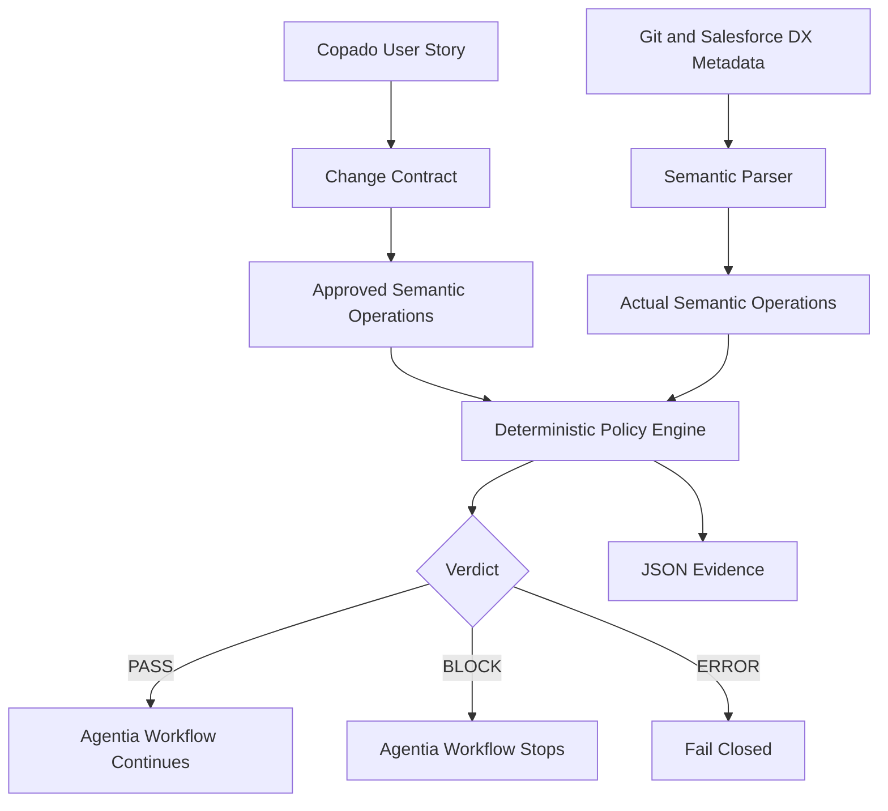

# PromotionProof

## Continuous Intent Verification for Salesforce Releases

> **Salesforce proves the metadata can deploy. Copado governs how it moves. PromotionProof proves this exact change is what the business authorized.**

PromotionProof is a custom Copado Agentia™ Headless CLI plugin that detects technically valid but functionally unauthorized Salesforce metadata changes before they advance through the release workflow.

## The Problem

A Salesforce release can be syntactically valid, merge cleanly, pass tests, and validate successfully while still containing functionality that the approved User Story never requested.

This can happen in shared metadata such as Custom Fields, picklists, Permission Sets, Profiles, Flows, and destructive changes.

```text
Approved User Story:
+ API Failure Opt Out Exception

Actual release:
+ API Failure Opt Out Exception
+ Account Information Category
```

Both values are valid Salesforce metadata. The second value is not authorized by the User Story.

Traditional delivery controls ask **“Can this deploy?”** PromotionProof adds another question: **“Should this exact semantic change deploy for this User Story?”**

## The Solution

PromotionProof represents approved User Story scope as a machine-readable **Change Contract**, converts Salesforce metadata differences into semantic operations, and evaluates them using deterministic policy rules.

Implemented capabilities:

- CustomField/picklist additions and removals
- Unauthorized destructive-change detection
- PermissionSet field-permission escalation detection
- Human-readable terminal findings
- Machine-readable JSON evidence
- Deterministic CI/CD exit codes
- Agentia project-local quality-gate integration
- Copado work-item and publish-flow integration

Primary command:

```powershell
agentia promotion-proof check --story US-0000025
```

Agentia runs the same control through:

```powershell
agentia cicd work test --local
```

## Working Demo

The demo uses Copado User Story `US-0000025`.

### Approved intent

```text
Add "API Failure Opt Out Exception"
to Case.Sub_Category__c.

No other values should be added,
modified, or removed.
```

### Clean implementation

```text
Approved:
+ API Failure Opt Out Exception

Actual:
+ API Failure Opt Out Exception

PROMOTIONPROOF VERDICT: PASS
```

### Contaminated implementation

```text
Actual:
+ API Failure Opt Out Exception
+ Account Information Category
```

```text
PP-SCOPE-001
Unexpected semantic change: Account Information Category
PROMOTIONPROOF VERDICT: BLOCK
Exit code: 2
```

After the unrelated value is removed, the same Agentia gate returns `PASS`.

## Architecture



### Trust boundary

```text
AI may draft or explain.
Humans authorize scope.
Deterministic policy code decides PASS or BLOCK.
```

## Decision Model

| Verdict | Meaning | Exit code |
|---|---|---:|
| `PASS` | Every observed semantic operation is authorized | `0` |
| `BLOCK` | An unexpected or destructive operation is present | `2` |
| `ERROR` | Contract, Git baseline, or metadata could not be evaluated safely | `3` |

### Implemented policy rules

| Rule | Description |
|---|---|
| `PP-SCOPE-001` | Unexpected semantic addition |
| `PP-DESTRUCTIVE-001` | Unapproved semantic removal |
| `PP-PERM-001` | Unauthorized PermissionSet field-access expansion |

## Change Contract

```json
{
  "version": 1,
  "story": {
    "name": "US-0000025",
    "title": "PromotionProof Demo - Add API Failure Opt Out Exception"
  },
  "component": "Case.Sub_Category__c",
  "allowedPicklistAdds": [
    "API Failure Opt Out Exception"
  ],
  "blockedUnexpectedChanges": true
}
```

Contract location:

```text
.promotion-proof/contracts/US-0000025.json
```

## Quick Start

### Prerequisites

- Git
- Node.js 18+
- npm
- Copado Agentia™ Headless CLI
- Salesforce DX project
- Copado CI/CD authentication
- PowerShell on Windows for the current local gate

### Build and link the plugin

```powershell
cd agentia-promotion-proof
npm install
npm run build
agentia plugins link .
cd ..
```

### Run PromotionProof

```powershell
agentia promotion-proof check --story US-0000025
```

### Run through Agentia

```powershell
agentia cicd work test --local
```

## Machine-Readable Evidence

PromotionProof writes JSON evidence under:

```text
.promotion-proof/reports/
```

The report includes the User Story, Salesforce component, Git context, contract digest, approved operations, observed operations, findings, commit identity, and verdict.

## Agentia Integration

The TypeScript plugin lives under:

```text
agentia-promotion-proof/
└── src/commands/promotion-proof/check.ts
```

The Windows project-local quality gate is:

```text
.agentia_quality_gates.cmd
```

Agentia invokes it through:

```powershell
agentia cicd work test --local
```

## Repository Structure

```text
.
├── .agents/
├── .promotion-proof/contracts/
├── agentia-promotion-proof/
├── force-app/
├── promotion-proof/
├── .agentia_quality_gates.cmd
├── sfdx-project.json
└── README.md
```

## Security and Governance

- Secrets are not stored in the repository.
- Local `.agentia` credentials/configuration remain ignored.
- Unknown or unreadable policy inputs do not silently pass.
- AI is not the final authorization authority.
- Policy violations return non-zero process exit codes.
- Remediation requires changing the artifact or obtaining explicit authorization.

## What PromotionProof Does Not Replace

PromotionProof complements Salesforce validation, tests, dependency analysis, static analysis, Git review, Copado governance, and human approval. It adds **story-specific semantic authorization**.

## Current Limitations

This is a focused hackathon prototype.

- Picklist semantics are the primary end-to-end demonstration.
- PermissionSet support currently focuses on field permissions.
- Flow semantic analysis is not yet implemented.
- Natural-language contract drafting is planned.
- Copado Result persistence is planned.
- Promotion-level aggregate verification is planned.
- Environments without an active Local Quality Gate Extension Configuration can show a result-upload warning; local enforcement still uses the process exit code.

## Roadmap

- Human-approved contract versions and SHA-256 digests
- Exact commit and deployment-manifest binding
- PermissionSet and Profile policy expansion
- Flow semantic operation support
- Promotion-level Release Intent Graph
- Cross-story semantic collision detection
- Copado Result persistence
- Signed release attestations
- Agent Skill for explain/remediate/re-run workflows
- SARIF and pull-request annotations

## Hackathon Value

PromotionProof demonstrates a real enterprise governance gap, a working Agentia extension, deterministic semantic analysis, Agentia gate enforcement, Salesforce DX/Git integration, Copado work-item integration, and a memorable `PASS → contamination → BLOCK → correction → PASS` sequence.

> **PromotionProof prevents technically successful but functionally unauthorized Salesforce releases.**

## Public Repository

<https://github.com/PratikDTiwari/Copado-PromotionProofSFP>

Hackathon implementation branch: `feature/US-0000025`

## Author

**Pratik Tiwari**  
Salesforce DevOps Architect  
LinkedIn: <https://www.linkedin.com/in/pratikdtiwari/>

## License

MIT
